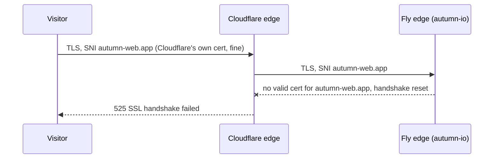

# Runbook: Cloudflare `525 SSL handshake failed`

**Symptom.** `https://autumn-web.app` shows Cloudflare's *Error 525: SSL
handshake failed*, while `https://autumn-io.fly.dev/health` answers `200`.

**Meaning.** The app is fine; Fly's edge refuses the TLS handshake for the
*custom* hostname. Cloudflare connects to Fly with `autumn-web.app` as SNI, and
Fly will only complete that handshake with a valid certificate it holds for that
exact name. The `*.fly.dev` certificate does not cover it.



## What happened on 2026-10-09

Certificate Transparency logs (`crt.sh/?q=autumn-web.app`) show Fly's Let's
Encrypt pair for `autumn-web.app` (issued 2026-07-11) expired on 2026-10-09 with
no renewal ever issued. Fly tries to renew about 30 days before expiry, so it
had been failing since early September. Both ACME challenges were blocked by
Cloudflare:

| Challenge | Why it failed |
| --- | --- |
| DNS-01 | `_acme-challenge.autumn-web.app` was a **proxied** (orange-cloud) record, so it answered with Cloudflare's IPs. Let's Encrypt never saw the CNAME to Fly's `flydns.net` validation name. |
| HTTP-01 | Cloudflare redirects `http://` to `https://` (`301`), so the challenge never reached Fly on port 80 in plain HTTP. |
| TLS-ALPN-01 | Can't work behind any TLS-terminating proxy. |

`.github/workflows/origin-tls.yml` now checks this every day, so a stalled
renewal turns CI red with about two weeks to spare.

## Fix

These are Fly and Cloudflare dashboard/CLI changes; nothing in this repo deploys
them.

1. **Get Fly's validation target.**

   ```sh
   fly certs show autumn-web.app -a autumn-io
   ```

   It prints a DNS-validation instruction of the form
   `_acme-challenge.autumn-web.app  CNAME  autumn-web.app.<id>.flydns.net`.
   If it says the hostname isn't found, run `fly certs add autumn-web.app -a autumn-io`
   first.

2. **Point the challenge record at Fly, unproxied.** In Cloudflare, go to
   **DNS → Records** and edit (or create) `_acme-challenge`:
   - Type **CNAME**, target exactly the `…flydns.net` name from step 1.
   - Proxy status **DNS only** (grey cloud). This is the setting that broke
     renewal. A proxied record hides the CNAME from Let's Encrypt.

   Leave the apex `autumn-web.app` record proxied. Only the challenge record
   must be grey.

3. **Ask Fly to validate and issue.**

   ```sh
   fly certs check autumn-web.app -a autumn-io
   ```

   Repeat until it reports the certificate as issued (usually within a couple of
   minutes). If it stays stuck after DNS has propagated, as a last resort run
   `fly certs remove autumn-web.app -a autumn-io` then
   `fly certs add autumn-web.app -a autumn-io` to force a fresh order.

4. **Verify.**

   ```sh
   scripts/check-origin-tls.sh autumn-web.app   # asks Fly directly
   curl -sSI https://autumn-web.app/health      # through Cloudflare, expect 200
   ```

   Then run the **Origin TLS** workflow manually (Actions → Origin TLS → Run
   workflow) to confirm it's green.

## Don't do this

- **Cloudflare SSL mode → Flexible.** Cloudflare would then talk plain HTTP to
  Fly, and `force_https = true` in `fly.toml` redirects that back to HTTPS. The
  result is an infinite redirect loop instead of a 525.
- **Cloudflare SSL mode → Full (not strict).** It skips certificate validation,
  but a 525 means the handshake itself never completes, so it doesn't help.
- **Proxying `_acme-challenge` again.** Renewal fails silently, and the site
  goes down when the current certificate expires.

## Related

- `www.autumn-web.app` is in `autumn.toml`'s `trusted_hosts`, but it has no DNS
  record and Fly has never issued a certificate for it. If it should serve, add
  a proxied DNS record in Cloudflare, run `fly certs add www.autumn-web.app -a autumn-io`,
  give it its own unproxied `_acme-challenge.www` CNAME, and add it to the
  hosts in `origin-tls.yml`.
